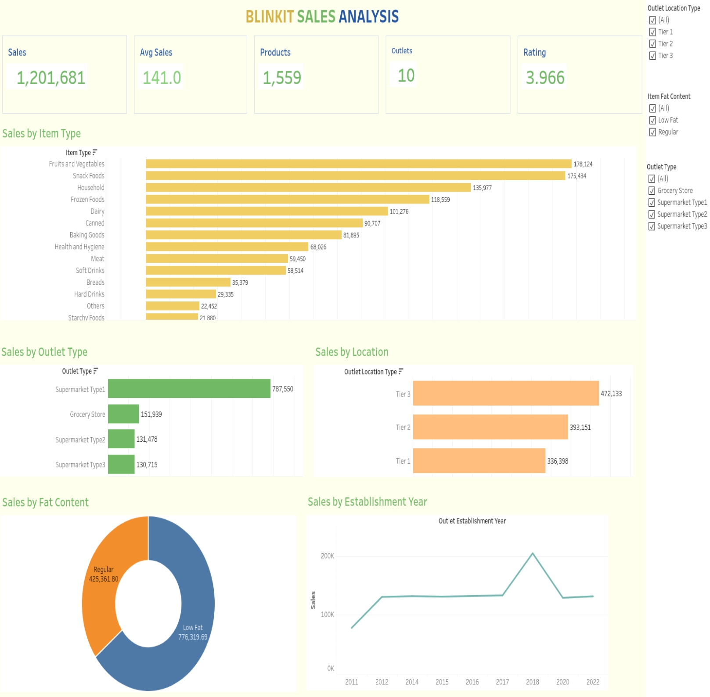

# Blinkit Data Analysis Project

An end-to-end grocery retail sales analysis project using Python, MySQL, Excel, and Tableau. The project covers data understanding, data cleaning, exploratory data analysis, SQL analysis, and interactive dashboard development.

## Tableau Dashboard



**[View the interactive dashboard on Tableau Public](https://public.tableau.com/views/Blinkit_Sales_Analysis/BlinkitSalesOverview?:language=en-GB)**

## Project Overview

The analysis explores sales performance across product categories, outlet types, outlet location tiers, fat-content categories, and outlet establishment years.

### Tools and Technologies

- **Python:** Data preparation and exploratory data analysis
- **Pandas:** Data manipulation and cleaning
- **Matplotlib:** Data visualization
- **MySQL:** SQL-based data analysis
- **Microsoft Excel:** EDA summary reporting
- **Tableau:** Interactive dashboard development

## Repository Structure

```text
blinkit_data_analysis/
│
├── dataset/
│   ├── blinkit_sales_cleaned.csv
│   └── BlinkIT-Grocery-Data.csv
│
├── Reports/
│   └── blinkit_eda_summary.xlsx
│
├── sql_scripts/
│
├── Tableau/
│   ├── Blinkit_Sales_Analysis.twbx
│   ├── Blinkit_Sales_Analysis_2864.twb
│   └── Blinkit_Template.twb
│
├── up_notebook/
│   ├── 01_Data_Understanding.ipynb
│   ├── 02_Data_Cleaning.ipynb
│   └── 03_EDA.ipynb
│
├── Blinkit_Dashboard_Preview.jpeg
├── requirements.txt
└── README.md
```

## Dataset Overview

- **Records:** 8,523
- **Columns:** 12
- **Distinct products:** 1,559
- **Outlets:** 10

The dataset includes product attributes, outlet details, item visibility, sales, and ratings.

## Data Cleaning and Preparation

The data preparation workflow includes:

- Reviewing the dataset structure and data types.
- Standardizing `Item Fat Content` categories, including inconsistent labels.
- Handling missing `Item Weight` values using a hierarchical median-imputation approach.
- Checking the cleaned data for missing values and consistency.
- Saving the cleaned dataset for analysis.

## Dashboard KPIs

The Tableau dashboard presents these summary metrics:

| KPI | Value |
|---|---:|
| Total Sales | 1,201,681 |
| Average Sales | 141.0 |
| Total Products | 1,559 |
| Total Outlets | 10 |
| Average Rating | 3.966 |

## Dashboard Visualizations

1. **Sales by Item Type** – compares sales across product categories.
2. **Sales by Outlet Type** – compares sales across outlet formats.
3. **Sales by Location** – compares sales across outlet location tiers.
4. **Sales by Fat Content** – compares sales for Low Fat and Regular products.
5. **Sales by Establishment Year** – compares sales by the year an outlet was established.

### Interactive Filters

The dashboard includes filters for:

- Outlet Location Type
- Outlet Type
- Item Fat Content

These filters allow users to explore the dashboard using different outlet and product selections.

## Key Findings

- Fruits and Vegetables and Snack Foods are the highest-sales item categories in the dataset.
- Supermarket Type 1 has the highest sales among the outlet types shown.
- Tier 3 outlets have the highest sales among the location tiers shown.
- Low Fat products contribute approximately 64.6% of total sales.

## Important Dataset Notes

- This is a historical grocery retail dataset commonly referred to as Blinkit sales data; it is not verified live Blinkit transaction data.
- `Outlet Establishment Year` refers to the outlet's establishment year, not the transaction year.
- The dataset does not provide customer-level transaction records or profit/cost fields. Therefore, this project focuses on sales patterns rather than customer behavior or profitability.

## How to Explore the Project

1. Review the notebooks in `up_notebook/` to follow the data understanding, cleaning, and EDA workflow.
2. Open `Reports/blinkit_eda_summary.xlsx` to review the EDA summary.
3. Explore the SQL scripts in `sql_scripts/`.
4. Open the packaged Tableau workbook in `Tableau/Blinkit_Sales_Analysis.twbx` using Tableau Desktop.
5. Use the Tableau Public link above to interact with the published dashboard online.

## Author

**Pavan Kumar Sripada**
